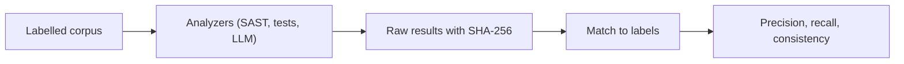
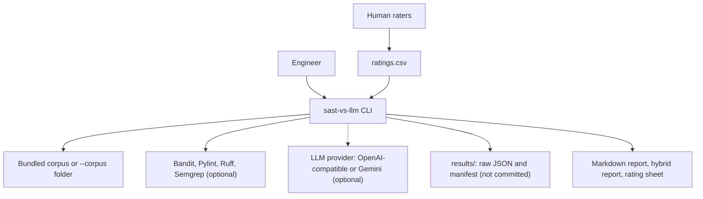
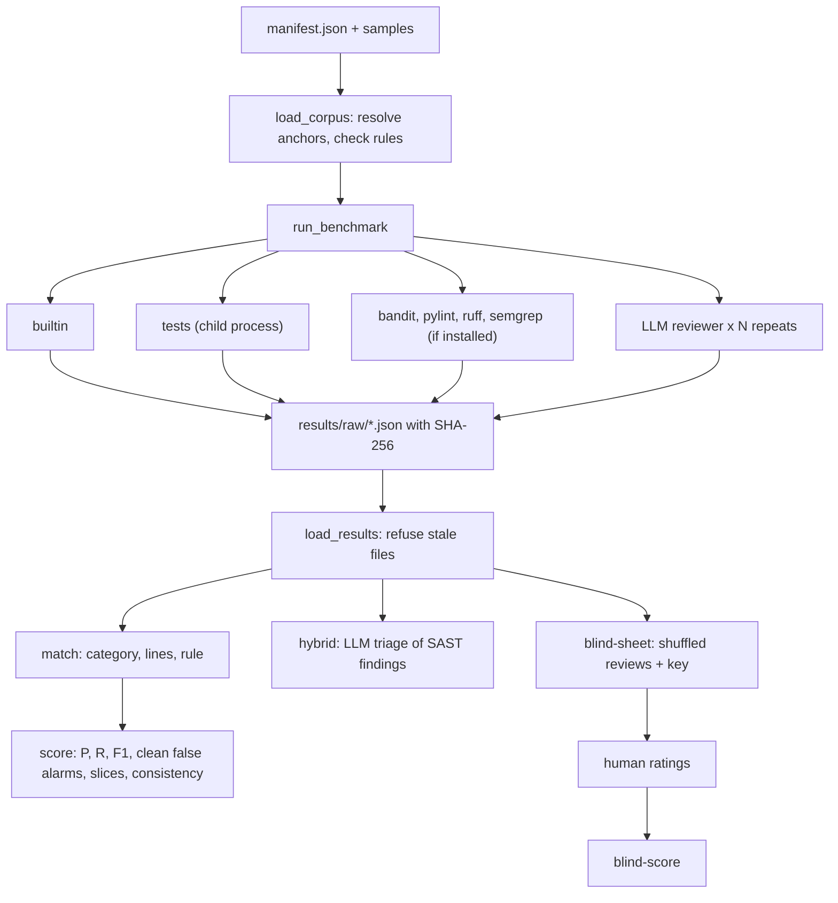

<div align="center">

# sast-vs-llm — A Reproducible Benchmark of Static Analyzers and LLM Code Reviewers

**sast-vs-llm is a benchmark for engineers who want to know which code reviewer finds real problems. It takes a labelled Python corpus through these steps to precision, recall and consistency for each analyzer:**

`validate corpus` → `run analyzers` → `store raw results` → `match to labels` → `score` → `triage and blind rating`.


**[Summary](#1-summary)** ·
**[Workflow](#4-the-end-to-end-workflow)** ·
**[Run it](#14-how-to-run-sast-vs-llm)** ·
**[Configuration](#144-environment-variables)** ·
**[Known problems](#17-known-problems)** ·
**[Glossary](#19-glossary)**

</div>

> [!NOTE]
> This README uses ASD-STE100 Simplified Technical English. The writing rules and the project
> vocabulary are in [`docs/ste-style-guide.md`](docs/ste-style-guide.md). Each term in the
> [Glossary](#19-glossary) has only one meaning.

---

sast-vs-llm compares static analyzers (SAST tools) and LLM reviewers on Python code with known problems.
Each sample of the corpus has planted labels: a category, a rule and the lines.
Each analyzer writes raw findings with provenance, and a matcher pairs findings with labels.
Thus precision, recall, false alarms and consistency are measured, not judged by opinion.

This README is the **one location that explains all of sast-vs-llm**. It gives these topics:

- the general design
- each component and its procedure, step by step
- the matching and scoring rules
- the data map
- the runbook
- the validation results and the known problems

| If you are… | Read |
|---|---|
| A manager or reviewer | [1](#1-summary), [3](#3-design-rules), [4](#4-the-end-to-end-workflow), [16](#16-validation-results), [18](#18-key-points) |
| A developer who joins the project | All sections, in sequence. Keep [14](#14-how-to-run-sast-vs-llm) and [17](#17-known-problems) open while you work |
| An operator who runs sast-vs-llm | [14](#14-how-to-run-sast-vs-llm), then the section for the component that you use |

---

## Table of contents

1. 🧭 [Summary](#1-summary)
2. 🏗️ [How sast-vs-llm is built](#2-how-sast-vs-llm-is-built)
   - 2.1 [Components](#21-components)
   - 2.2 [System context](#22-system-context)
   - 2.3 [Repository layout](#23-repository-layout)
3. 🛡️ [Design rules](#3-design-rules)
4. 🔄 [The end-to-end workflow](#4-the-end-to-end-workflow)
   - 4.1 [Full flow](#41-full-flow)
   - 4.2 [The life cycle of one finding](#42-the-life-cycle-of-one-finding)
5. 🔵 [The labelled corpus](#5-the-labelled-corpus)
6. 🟢 [The static analyzers](#6-the-static-analyzers)
7. 🟣 [The LLM reviewer](#7-the-llm-reviewer)
8. 🎯 [The matcher and the scores](#8-the-matcher-and-the-scores)
9. 🧪 [Hybrid triage](#9-hybrid-triage)
10. 🙈 [Blinded human rating](#10-blinded-human-rating)
11. 🖥️ [The CLI](#11-the-cli)
12. ⚖️ [The decision rules](#12-the-decision-rules)
13. 🗂️ [Data and file map](#13-data-and-file-map)
14. ▶️ [How to run sast-vs-llm](#14-how-to-run-sast-vs-llm)
    - 14.1 [Prerequisites](#141-prerequisites) · 14.2 [Installation](#142-installation) · 14.3 [Run sast-vs-llm](#143-run-sast-vs-llm) · 14.4 [Environment variables](#144-environment-variables)
15. 🧩 [How to extend sast-vs-llm](#15-how-to-extend-sast-vs-llm)
16. ✅ [Validation results](#16-validation-results)
17. ⚠️ [Known problems](#17-known-problems)
18. 📌 [Key points](#18-key-points)
19. 📖 [Glossary](#19-glossary)
20. 📄 [License](#20-license)

---

## 1. Summary

**The problem.** Teams ask if an LLM is a better code reviewer than a SAST tool. These questions are difficult:

- Which problems does the code contain, so that a finding can be correct or wrong?
- How do you compare a tool report with a chat reply in the same units?
- How do you know that a tool result belongs to the code that you have now?
- Does the LLM give the same answer two times, and does it invent metrics?
- Do people prefer a reviewer because they know its name?

sast-vs-llm gives each of these questions its own component. Each component has tests that prove its rule.

| Item | Value |
|---|---|
| Input | The bundled corpus (30 samples, 23 labels, 30 unit tests), or your own corpus folder |
| Output | Raw JSON results, a Markdown score report, a hybrid report and a blinded rating sheet |
| Components | **13** modules: findings, corpus, analyzers (builtin, unit tests, external), llm, review, matching, metrics, runner, scoring, hybrid, blind, config, cli |
| Analyzers | `builtin` (AST rules), `tests` (unit tests), `bandit`, `pylint`, `ruff`, `semgrep`, and an LLM reviewer |
| Providers | OpenAI-compatible servers (OpenAI, LM Studio, Ollama, vLLM) and Gemini. All optional |
| Offline mode | `builtin`, `tests` and the simulated reviewer. No key, no network, no tool installation |
| Safety | Labels resolve from anchors. Raw results carry the SHA-256 of the sample. Ungrounded LLM fields are dropped |
| Tests | **87** pass and **1** skips without Bandit (`pytest`). With the `sast` extra, all **88** pass |



---

## 2. How sast-vs-llm is built

### 2.1 Components

| Component | Module | Purpose |
|---|---|---|
| Findings | `src/sast_vs_llm/findings.py` | `Finding` record, categories, canonical rules, rule families |
| Corpus | `src/sast_vs_llm/corpus.py` | Load the manifest, resolve anchors, check the corpus rules |
| Builtin analyzer | `src/sast_vs_llm/analyzers/builtin.py` | 16 AST rules for security and maintainability, no dependencies |
| Unit-test analyzer | `src/sast_vs_llm/analyzers/unit_tests.py` | Run sample tests in an isolated child process |
| External analyzers | `src/sast_vs_llm/analyzers/external.py` | Bandit, Pylint, Ruff and Semgrep runners and JSON parsers |
| LLM clients | `src/sast_vs_llm/llm.py` | OpenAI-compatible, Gemini, scripted and simulated clients |
| LLM reviewer | `src/sast_vs_llm/review.py` | Versioned prompt, strict JSON parser, provenance |
| Matching | `src/sast_vs_llm/matching.py` | One-to-one pairs of labels and findings |
| Metrics | `src/sast_vs_llm/metrics.py` | Precision, recall, F1, Wilson intervals, Jaccard |
| Runner | `src/sast_vs_llm/runner.py` | Run analyzers, write raw results, refuse stale results |
| Scoring | `src/sast_vs_llm/scoring.py` | Score tables and the Markdown report |
| Hybrid | `src/sast_vs_llm/hybrid.py` | LLM triage of SAST findings and its measurement |
| Blind rating | `src/sast_vs_llm/blind.py` | Blinded rating sheet, key file and rating scores |
| Settings | `src/sast_vs_llm/config.py` | Environment variables and the analyzer factory |
| CLI | `src/sast_vs_llm/cli.py` | The `sast-vs-llm` command with 8 subcommands |

### 2.2 System context



### 2.3 Repository layout

```
sast-vs-llm/
├── .github/workflows/ci.yml     # CI: Python 3.11, pip install -e ".[dev]", pytest -q
├── .env.example                 # the 9 environment variable names, no values
├── pyproject.toml               # no core dependencies, extras sast and dev, sast-vs-llm script
├── data/README.md               # corpus format and how to use your own corpus
├── docs/ste-style-guide.md      # writing rules and project vocabulary
├── src/sast_vs_llm/
│   ├── corpus/manifest.json     # 30 samples: labels with anchors, unit tests
│   ├── corpus/samples/*.py      # the samples (planted problems, on purpose)
│   ├── prompts/review_v1.txt    # the versioned reviewer prompt
│   ├── analyzers/               # builtin.py, unit_tests.py, external.py
│   ├── findings.py  corpus.py   # records and corpus rules
│   ├── llm.py  review.py        # LLM clients and the LLM reviewer
│   ├── matching.py  metrics.py  scoring.py
│   ├── runner.py  hybrid.py  blind.py
│   └── config.py  cli.py
└── tests/                       # 88 tests, no network, no API keys
```

---

## 3. Design rules

### 3.1 Each sample has ground truth
Each label has a category, a canonical rule and a line range. Clean controls have no labels, so a finding on them is a false alarm. `check_corpus` refuses a non-clean sample without labels and a buggy sample without a unit test.

### 3.2 Labels point to code, not to line numbers
A label names an anchor text that occurs exactly once in its sample. The loader finds the line. If an edit removes or repeats the anchor, `load_corpus` raises `CorpusError`.

### 3.3 Variants must differ
Two samples with the same syntax tree (docstrings removed) make the corpus invalid. This stops an "optimized" file that is a copy of another variant.

### 3.4 Each result belongs to the code that the analyzer saw
Each raw result stores the SHA-256 of its sample file. `load_results` raises `StaleResultError` if the file changed after the run.

### 3.5 The LLM reviewer is scripted and recorded
The prompt is a versioned file. The temperature is 0 by default, and each repeat sends its own seed. Each raw result stores the model, temperature, prompt version, prompt hash, latency and parse notes.

### 3.6 An LLM cannot add metrics
The parser accepts only six finding fields. Each other field, for example `coverage` or a grade, is an ungrounded field. The parser drops it and the report counts it.

### 3.7 Accuracy and preference are separate
The score report uses only matches against labels. The usefulness rating uses a blinded sheet, and a separate key file maps each item to its reviewer.

### 3.8 Problems of the earlier study and their fixes

| # | Problem in the earlier study | Fix in sast-vs-llm | Test |
|---|---|---|---|
| 1 | Nine algorithm files, no security code, so no statistical power | 30 samples: 14 with security labels, 10 clean controls, Wilson intervals on each rate | `test_bundled_corpus_is_valid` |
| 2 | No ground truth, so no precision or recall | Labels with category, rule and lines. A matcher scores each finding | `tests/test_matching_metrics.py` |
| 3 | Hidden hard-coded test-case hacks that nobody reported | Planted logic errors and a `tests` analyzer that runs unit tests | `test_unit_tests_expose_hidden_logic_errors` |
| 4 | An "optimized" file equal to another variant | `check_corpus` refuses two samples with the same syntax tree | `test_identical_variants_are_refused` |
| 5 | LLM replies with invented coverage and grades | Strict parser. Ungrounded fields are dropped and counted | `test_parse_fenced_json_and_ungrounded_fields` |
| 6 | Tool reports that do not match the shipped code | SHA-256 in each raw result. Stale results are refused | `test_stale_results_are_refused` |
| 7 | Manual chat runs, no recorded prompt, model or temperature, one run | API clients, versioned prompt, temperature 0, N repeats, provenance in each file | `test_reviewer_records_provenance` |
| 8 | Preference survey without blinding | Blinded rating sheet with a separate key and a scoring command | `test_blind_sheet_hides_reviewer_names` |

---

## 4. The end-to-end workflow

### 4.1 Full flow



### 4.2 The life cycle of one finding

1. The runner gives one sample to one analyzer.
2. The analyzer returns a `Finding` with a category, a rule, a line range and a message.
3. The runner writes the finding to a raw result with the sample SHA-256 and the analyzer version.
4. `load_results` reads the raw result and compares the SHA-256 with the current sample file.
5. The matcher pairs the finding with the closest label of the same category within 2 lines.
6. A paired finding is a true positive. An unpaired finding is a false positive.
7. Each unpaired label is a false negative.

---

## 5. The labelled corpus

**Purpose.** Give each analyzer the same code with known problems.

| Kind | Samples | Labels | Contents |
|---|---|---|---|
| `vulnerable` | 14 | 15 | CWE-22, 78 (2), 89 (2), 95, 295, 328, 330, 377, 502 (2), 617, 798 (2) |
| `smelly` | 3 | 5 | Mutable default, deep nesting, shadowed builtin, unused variable, bare except |
| `buggy` | 3 | 3 | Hard-coded special case, wrong comparison, off-by-one |
| `clean` | 10 | 0 | Safe versions of 6 vulnerable samples and 4 correct algorithm samples |

The three algorithm problems of the earlier study stay in the corpus: valid anagram (easy), majority element II (medium) and word search II (hard). Each problem has a `functions`, a `class` and an `optimized` style.

**Procedure**

1. Read `manifest.json`.
2. For each sample, read the file and find each label anchor. The label lines are the anchor line plus `span` − 1.
3. Run `check_corpus`: ids, kinds, styles, difficulties, syntax, distinct variants, label rules and tests.
4. If a rule fails, raise `CorpusError` with each problem.

**Rules**

- The sample files contain no hint of their labels. A test checks for words such as `cwe` and `bug`.
- The canonical rule of a label must belong to its category.

---

## 6. The static analyzers

**Purpose.** Run each SAST tool in the same way and change its output into findings.

| Analyzer | How it runs | Rule mapping |
|---|---|---|
| `builtin` | In process, Python `ast` | 16 rules, direct canonical ids |
| `tests` | Child process `python -I`, `PYTHONHASHSEED=0`, 20 s limit | Each failed function gives `BUG-test-failure` on the function lines |
| `bandit` | `python -m bandit -f json` | Test id table (`B602` → CWE-78), else the reported CWE |
| `pylint` | `python -m pylint --output-format=json` | Symbol table. Other errors → `BUG-other`, other warnings and refactor notes → `SMELL-other` |
| `ruff` | `ruff check --select S,B,E722,F841,A --output-format json` | Code table (`S608` → CWE-89) |
| `semgrep` | `semgrep --config p/python --json` | CWE in the rule metadata |

**The builtin rules**

| Rule | Trigger |
|---|---|
| CWE-95 | `eval` or `exec` |
| CWE-78 | `os.system`, `os.popen`, or `subprocess.*` with `shell=True` |
| CWE-502 | `pickle.load(s)`, `marshal.loads`, `yaml.load` without a loader |
| CWE-328 | `hashlib.md5`, `hashlib.sha1`, `hashlib.new("md5")` |
| CWE-330 | `random.*` in a function whose name has token, password, secret, key, salt, otp or nonce |
| CWE-377 | `tempfile.mktemp` |
| CWE-295 | A call with `verify=False` |
| CWE-89 | `execute` with an f-string, `%`, `+` or `.format` text, also through a local variable |
| CWE-798 | A name such as password, secret, api_key or token set to a text of 6 or more characters |
| CWE-22 | `os.path.join` with a function argument |
| CWE-617 | `assert` in a function whose name has admin, auth, permission, login, delete or privilege |
| `SMELL-mutable-default` | A list, dict or set as a default value |
| `SMELL-bare-except` | `except:` with no type |
| `SMELL-unused-variable` | A local name that is assigned and never read |
| `SMELL-shadow-builtin` | A name such as `list`, `dict`, `id` or `type` that is assigned or is an argument |
| `SMELL-deep-nesting` | A block deeper than 4 levels. An `elif` chain does not add depth |

**Rules**

- If a tool is not installed, the runner skips it and records `not installed` in the manifest.
- Pylint messages that depend on the local packages (`import-error`, `no-name-in-module`, `import-outside-toplevel`) are dropped.
- Bandit import notes (`B403`, `B404`, `B603`, `B607`) are dropped, because no label is about an import.

---

## 7. The LLM reviewer

**Purpose.** Ask an LLM for findings in the same form as a SAST tool, with full provenance.

| Input | Output |
|---|---|
| One sample and an `LLMClient` | Findings, plus metadata: model, temperature, prompt version and hash, latency, ungrounded fields, dropped items, parse error |

**Procedure**

1. Send the system prompt `review_v1` and the sample with line numbers.
2. Send the repeat number as the seed. Use temperature 0 unless `SAST_LLM_TEMPERATURE` changes it.
3. Find the JSON in the reply, also inside a code fence.
4. Record each top-level field other than `findings`, and each finding field outside the six allowed fields, as ungrounded.
5. Drop each finding with an unknown category or a line outside the file. Record the reason.
6. Change a CWE text such as `cwe 89 (SQL)` into `CWE-89`. An unknown rule becomes `None`.
7. If the call fails, record the error and return no findings.

| Client | Endpoint | Key |
|---|---|---|
| `OpenAICompatibleClient` | `<base_url>/chat/completions` | `OPENAI_API_KEY`, necessary only for `api.openai.com` |
| `GeminiClient` | `models/<model>:generateContent` | `GEMINI_API_KEY` |
| `ScriptedLLM` | none | none (tests) |
| `SimulatedReviewer` | none | none (offline demo) |

> [!WARNING]
> Do not report numbers of `SimulatedReviewer` as LLM results. It runs the `builtin` analyzer and adds seeded noise.
> It drops 25 % of the findings and moves lines by up to 1.
> It adds an invented finding and a `coverage` field, each with a probability of 0.3.

---

## 8. The matcher and the scores

**Purpose.** Change findings into comparable numbers.

**Procedure**

1. For each sample, list all pairs of a label and a finding with the same category.
2. Keep a pair if the line ranges overlap after a tolerance of `--tol` lines (default 2).
3. In `--strict` mode, keep a pair only if the rule families are the same. `CWE-259` is in the family of `CWE-798`.
4. In `--strict` mode, `BUG-test-failure` and `BUG-other` match each correctness label.
5. Sort the pairs by line distance. Accept a pair if its label and its finding are both still free.
6. Count true positives, false positives and false negatives for each analyzer and category.

| Report table | Contents |
|---|---|
| Detection | TP, FP, FN, precision and recall with 95 % Wilson intervals, F1, for all categories and each category (repeat 0) |
| False alarms on clean controls | Share of clean controls with one or more findings, with a Wilson interval |
| Algorithm samples by difficulty and style | TP, FP, FN and recall for each slice of the 9 algorithm samples |
| Consistency over repeats | Mean pairwise Jaccard of finding keys (category, rule family, line / 3), and the F1 range |
| LLM output quality | Calls, replies with ungrounded fields, dropped findings, parse errors, mean latency |

---

## 9. Hybrid triage

**Purpose.** Measure if an LLM step removes false positives from SAST findings.

**Procedure**

1. Read the repeat-0 findings of one analyzer.
2. For each sample, send the code and the numbered findings with the prompt `TRIAGE_PROMPT_V1`.
3. Read `{"keep": [...]}` from the reply. An unreadable reply keeps all findings.
4. Match the findings before and after the triage. Report both sets of counts.

**Rules**

- If the LLM call fails, the triage keeps all findings.
- With the `simulated` provider, `SimulatedTriage` keeps a finding only if `builtin` reports the same category within 2 lines. It is not a language model.

---

## 10. Blinded human rating

**Purpose.** Measure usefulness without the effect of a known reviewer name.

**Procedure**

1. `blind-sheet` collects the repeat-0 review of each analyzer for each sample.
2. It shuffles the reviews with a seed and gives each one an item id `R0001`, `R0002` and so on.
3. It writes `ratings.csv` (item id, sample, file, review text, empty rating) and `ratings_key.json` (item id → analyzer).
4. Raters fill `usefulness_1_to_5`. Do not give the key file to the raters.
5. `blind-score` joins the ratings with the key. It reports the count, the mean and a 95 % interval for each analyzer.

**Rules**

- A rating outside 1 to 5, or an item id that is not in the key, stops the scoring with an error.
- Empty ratings are skipped.

---

## 11. The CLI

| Command | What it does |
|---|---|
| `sast-vs-llm corpus [--list] [--corpus D]` | Validate the corpus and print a summary |
| `sast-vs-llm analyze FILE` | Run the `builtin` analyzer on any Python file |
| `sast-vs-llm run [--analyzers L] [--repeats N] [--out D] [--corpus D]` | Run analyzers and write raw results |
| `sast-vs-llm score [--results D] [--strict] [--tol N] [--markdown F] [--allow-stale]` | Score stored results |
| `sast-vs-llm hybrid --analyzer A [--results D] [--strict]` | Measure LLM triage on one analyzer |
| `sast-vs-llm blind-sheet [--results D] [--sheet F] [--key F] [--seed N]` | Write the blinded rating sheet and key |
| `sast-vs-llm blind-score [--sheet F] [--key F]` | Score a filled rating sheet |
| `sast-vs-llm demo` | Offline demo: `builtin`, `tests` and the simulated reviewer |

**Rules**

- The CLI reads `--env-file` (default `.env`) first. A variable that is already set is not replaced.
- A `ConfigError`, `CorpusError`, `StaleResultError`, `LLMError`, `FileNotFoundError`, `KeyError` or `ValueError` prints `error: <message>`, and the exit code is 1.
- The default analyzer list of `run` is `builtin,tests,bandit,pylint,ruff,llm`.

---

## 12. The decision rules

| Rule | Value | Location |
|---|---|---|
| Line tolerance | 2 lines on each side (`--tol`) | `matching.match` |
| Rule check | Off by default. On with `--strict` | `matching.match` |
| Rule families | `CWE-259` → `CWE-798` | `findings.RULE_FAMILY` |
| Interval | 95 % Wilson score interval | `metrics.wilson` |
| Consistency key | (category, rule family, line // 3) | `Finding.key` |
| Default LLM repeats | 3 (`SAST_LLM_REPEATS`, 1 to 50) | `config.py` |
| Default temperature | 0 (`SAST_LLM_TEMPERATURE`, 0 to 2) | `config.py` |
| Unit-test time limit | 20 s for each sample | `unit_tests.run_tests` |
| Maximum nesting | 4 levels | `builtin.MAX_NESTING` |
| Minimum credential length | 6 characters | `builtin.py` |
| Default provider | `simulated` (`SAST_LLM_PROVIDER`) | `config.py` |

---

## 13. Data and file map

| Path | Committed? | Contents |
|---|---|---|
| `src/sast_vs_llm/corpus/` | Yes | Manifest and 30 samples |
| `src/sast_vs_llm/prompts/review_v1.txt` | Yes | Reviewer prompt |
| `data/README.md` | Yes | Corpus format and your own corpus |
| `results/manifest.json`, `results/raw/<analyzer>/<sample>__r<k>.json` | No (git ignores them) | Raw results of `run` |
| `ratings*.csv`, `ratings_key.json` | No (git ignores them) | Blinded rating sheet and key |
| `.env.example` | Yes | 9 variable names, no values |
| `.env` | No (git ignores it) | Local settings and API keys |

---

## 14. How to run sast-vs-llm

### 14.1 Prerequisites

| Need | For |
|---|---|
| Python 3.11+ | All components. The core has no dependencies |
| Extra `sast` (`bandit`, `pylint`, `ruff`) | The external analyzers |
| `semgrep` on the `PATH` | The `semgrep` analyzer (install it separately) |
| An OpenAI-compatible server or a Gemini key | A real LLM reviewer (optional) |

### 14.2 Installation

```bash
git clone https://github.com/KrishnaAnnavaram/sast-vs-llm.git
cd sast-vs-llm
python -m venv .venv
. .venv/bin/activate            # Windows: .venv\Scripts\activate
pip install -e ".[dev]"
pip install -e ".[sast]"        # optional: Bandit, Pylint, Ruff
```

### 14.3 Run sast-vs-llm

Offline:

```bash
sast-vs-llm demo
sast-vs-llm corpus --list
sast-vs-llm run --analyzers builtin,tests,bandit,pylint,ruff --out results
sast-vs-llm score --results results --markdown report.md
sast-vs-llm score --results results --strict
```

With a real LLM (a local server needs no key):

```bash
# .env
SAST_LLM_PROVIDER=openai
SAST_LLM_BASE_URL=http://localhost:11434/v1
SAST_LLM_MODEL=llama3.2
SAST_LLM_REPEATS=5

sast-vs-llm run --analyzers builtin,tests,bandit,pylint,ruff,llm --out results
sast-vs-llm score --results results
sast-vs-llm hybrid --results results --analyzer pylint
sast-vs-llm blind-sheet --results results
sast-vs-llm blind-score
```

### 14.4 Environment variables

| Variable | Used by | Meaning |
|---|---|---|
| `SAST_LLM_PROVIDER` | LLM reviewer, hybrid | `simulated` (default), `openai`, `gemini` or `none` |
| `SAST_LLM_MODEL` | LLM clients | Model id. Default `gpt-4.1-mini` or `gemini-2.5-flash` |
| `SAST_LLM_BASE_URL` | LLM clients | Server URL. Default: the provider URL |
| `SAST_LLM_TEMPERATURE` | LLM clients | 0 to 2. Default 0 |
| `SAST_LLM_REPEATS` | `run` | LLM repeats, 1 to 50. Default 3 |
| `SAST_LLM_TIMEOUT` | LLM clients | HTTP time limit in seconds. Default 120 |
| `SAST_RESULTS_DIR` | `run`, `score`, `hybrid`, `blind-sheet` | Results folder. Default `results` |
| `OPENAI_API_KEY` | OpenAI client | Necessary for `api.openai.com` |
| `GEMINI_API_KEY` | Gemini client | Necessary for `gemini` |

Credentials are only in a local `.env` file. Git ignores this file. Do not print or commit credentials.

---

## 15. How to extend sast-vs-llm

| You want to… | Do this | Code change? |
|---|---|---|
| Add a sample | Add a file to `corpus/samples/` and an entry to `manifest.json`. Run `sast-vs-llm corpus` | No |
| Use another corpus | Make a folder with the same layout. Pass `--corpus` | No |
| Add a SAST tool | Add a class with `name`, `version`, `available()` and `analyze(sample)` and a JSON parser. Add it to `build_analyzers` | Small |
| Add a rule id | Add it to `RULES` in `findings.py` and to the tool mapping tables | Small |
| Change the prompt | Add `prompts/review_v2.txt` and pass `prompt_version="review_v2"` | Small |
| Add an LLM provider | Make a class with `complete(system, user, seed)`. Add it to `build_llm` | Small |

Planned milestones (not built):

- **M7:** a converter for CWE-annotated public Python sets into the manifest format.
- **M8:** a SonarQube runner through the web API.
- **M9:** bootstrap intervals over samples for F1.

---

## 16. Validation results

| Validation | Result | Command |
|---|---|---|
| Unit tests, clean venv with `pip install -e ".[dev]"` (as in CI) | **87 passed, 1 skipped** | `pytest -q` |
| Unit tests with the `sast` extra | **88 passed** | `pytest -q` |
| Corpus check | 30 samples, 23 labels, 30 unit tests, 376 lines, 0 problems | `sast-vs-llm corpus` |

**Local benchmark run** (bundled corpus, repeat 0, tolerance 2, category matching). Bandit 1.9.4, Pylint 4.1.2 and Ruff 0.16.10 ran on Windows with Python 3.13. Semgrep was not installed. CI does not run these tools.

| Analyzer | TP | FP | FN | Precision (95 % CI) | Recall (95 % CI) | F1 | Clean controls flagged |
|---|---|---|---|---|---|---|---|
| `builtin` | 20 | 0 | 3 | 1.00 (0.84–1.00) | 0.87 (0.68–0.95) | 0.93 | 0 / 10 |
| `ruff` | 18 | 0 | 5 | 1.00 (0.82–1.00) | 0.78 (0.58–0.90) | 0.88 | 0 / 10 |
| `bandit` | 14 | 0 | 9 | 1.00 (0.78–1.00) | 0.61 (0.41–0.78) | 0.76 | 0 / 10 |
| `pylint` | 5 | 8 | 18 | 0.38 (0.18–0.64) | 0.22 (0.10–0.42) | 0.28 | 1 / 10 |
| `tests` | 3 | 0 | 20 | 1.00 (0.44–1.00) | 0.13 (0.05–0.32) | 0.23 | 0 / 10 |
| simulated reviewer (not an LLM) | 15 | 13 | 8 | 0.54 (0.36–0.70) | 0.65 (0.45–0.81) | 0.59 | 3 / 10 |

| Measured fact | Value |
|---|---|
| Security recall of Bandit and Ruff | 14 / 15 each. Both miss the CWE-22 path traversal |
| Correctness recall | 0 / 3 for all static analyzers. 3 / 3 for `tests` |
| Pylint false positives | 8: mostly `too-few-public-methods` and `attribute-defined-outside-init`, which no label covers |
| Strict mode (rule family) | Same totals for each analyzer in this run |
| Simulated reviewer over 3 repeats | Mean Jaccard 0.38, F1 0.59 to 0.77, 26 of 90 replies with an ungrounded field |
| Simulated triage on Pylint findings | FP 8 → 0, TP 5 → 5 |

These numbers prove that the pipeline measures what it says. They do not rank LLMs, because no real LLM ran here.
The `builtin` score is an upper bound: the same author wrote the corpus and the rules. Do not cite it as a tool comparison.
The simulated triage uses `builtin` as its reference, so its gain on Pylint is circular.

---

## 17. Known problems

Read these problems before you use sast-vs-llm for a decision.

| # | Area | Problem | Impact and action |
|---|---|---|---|
| 1 | Corpus size | 30 samples and 23 labels give wide intervals (for example 0.41–0.78) | Add samples, or load a public CWE-annotated set |
| 2 | Corpus author | The corpus and the `builtin` rules have the same author | Treat `builtin` as a reference, not as a competitor |
| 3 | Labels | The labels are not complete. A real problem without a label counts as a false positive | Read the false positives before you judge a tool |
| 4 | LLM results | No real LLM ran in this repository | Run with your provider and report the model and date |
| 5 | Category matching | A finding in another category does not match. For example, Pylint reports `yaml.load` as a call error, but the label is CWE-502 | Read the raw results for such cases |
| 6 | Tool versions | Tool rules change between versions | The manifest records each version. Compare runs with the same versions |
| 7 | Semgrep | Not installed in the local run | Install it and add `semgrep` to `--analyzers` |
| 8 | Unit tests | The `tests` analyzer runs sample code in a child process | Run only corpora that you trust |
| 9 | Simulated triage | It uses `builtin` as its reference | Use it only to check the hybrid procedure |

---

## 18. Key points

1. **Each sample has ground truth.** Labels with a category, a rule and lines make precision and recall possible.
2. **Clean controls measure false alarms.** A finding on a clean control is always wrong.
3. **Unit tests find what SAST does not.** All static analyzers missed the 3 planted logic errors. The `tests` analyzer found all 3.
4. **Results cannot go stale.** Each raw result carries the SHA-256 of its sample.
5. **LLM runs are reproducible and recorded.** Versioned prompt, temperature 0, seeds, repeats and provenance in each file.
6. **Invented metrics are removed.** The parser drops ungrounded fields and counts them.
7. **Preference is blinded and separate from accuracy.**

---

## 19. Glossary

| Term | Meaning |
|---|---|
| **Analyzer** | One component that returns findings for a sample |
| **Category** | `security`, `maintainability` or `correctness` |
| **Clean control** | A sample with no labels |
| **Corpus** | The labelled samples and `manifest.json` |
| **False alarm** | One or more findings on a clean control |
| **Finding** | One reported problem: category, rule, lines and message |
| **Label** | One planted problem: category, rule and lines |
| **LLM reviewer** | The analyzer that sends a sample to an LLM with the fixed prompt |
| **Match** | One label and one finding that agree on category, lines and (in strict mode) rule |
| **Rating sheet** | The blinded CSV that human raters fill |
| **Raw result** | One JSON file with the findings of one analyzer for one sample and repeat |
| **Repeat** | One more run of an LLM reviewer on the same sample |
| **Rule** | A canonical id: a CWE id, `SMELL-*` or `BUG-*` |
| **Sample** | One Python file of the corpus |
| **Simulated reviewer** | The offline stand-in for an LLM reviewer. It is not a language model |
| **Triage** | The LLM step that keeps or drops each SAST finding |
| **Ungrounded field** | A field in an LLM reply that the schema does not allow |

---

## 20. License

[MIT](LICENSE) © 2026 Krishna Annavaram
